  
  
  
  

  

  

  

  

<a href="https://github.com/codedbymuneeb/codedbymuneeb/actions/workflows/snake.yml">
  <picture>
    <source media="(prefers-color-scheme: dark)" srcset="https://raw.githubusercontent.com/codedbymuneeb/codedbymuneeb/output/contribution-snake.svg">
    <source media="(prefers-color-scheme: light)" srcset="https://raw.githubusercontent.com/codedbymuneeb/codedbymuneeb/output/contribution-snake.svg">
    
  </picture>
</a>

  

  
  
  
  

